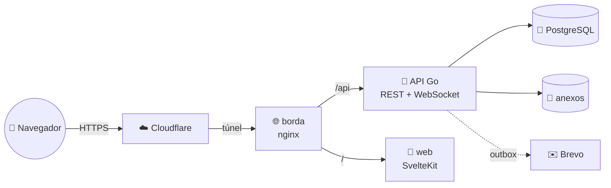

# 🗂️ stacktrack


**Quadro Kanban colaborativo em tempo real.** Várias pessoas movem cards no
mesmo quadro e todas veem na hora, sem recarregar a página — com convite por
email, papéis, histórico de quem mexeu em quê e um link público para quem só
acompanha.

🔗 **[stacktrack.d4ffy.com](https://stacktrack.d4ffy.com)**

Projeto de estudo. O eixo é **concorrência em Go e sincronização de estado entre
clientes**: o que acontece quando duas pessoas mexem na mesma coisa ao mesmo
tempo, e como cada tela fica sabendo. O caminho até aqui, e o que ainda falta,
está em [docs/historico-do-projeto.md](docs/historico-do-projeto.md).

---

## O que ele faz

- **Quadro, colunas e cards** — arrastar e soltar, com cor por coluna (o card
  herda a da etapa) e descrição em Markdown. Mover um card reescreve **uma
  linha**: duas pessoas arrastando ao mesmo tempo não desfazem o trabalho uma da
  outra.
- **Tempo real** — a mudança de um aparece na tela dos outros sem recarregar,
  inclusive no card aberto. Mostra **quem está no quadro** e **quem está
  editando cada coluna**; caiu a conexão, a tela avisa, reconecta sozinha e
  recebe o que perdeu.
- **Edição sem atropelo** — duas pessoas editando o mesmo card: a primeira a
  salvar ganha, e a segunda é avisada **com o texto dela preservado**.
- **Tudo o que pende de um card** — responsáveis, etiquetas, prazo (com
  "vencido"), checklists com progresso, anexos (link ou arquivo), comentários e
  o histórico do card.
- **Convite por email** — o dono informa o email e o papel (**dono**,
  **editor** ou **leitor**). Quem não tem conta cria uma pelo próprio convite;
  quem tem entra com a conta de sempre, e o quadro aparece em "Compartilhados
  com você" — só ele, e não os outros quadros do dono. A tela mostra se o email
  saiu, e o convite se reenvia ou revoga.
- **Histórico do quadro** — quem criou, moveu, renomeou, apagou, comentou,
  entrou ou saiu, com filtro por pessoa. Todo card movido mostra "movido por Ana
  há 5 min".
- **Link público** — o quadro em modo de leitura para quem não tem conta: o
  andamento do trabalho sai; comentários, nomes de quem trabalha e anexos, não.
- **Recuperar a senha** — o link chega por email, vale uma hora e uma vez, e
  trocar a senha tira a conta de todos os aparelhos. Pedir não revela se o
  email tem conta.
- **Filtro** por responsável, etiqueta e "só vencidos".
- **No celular** — toque abre o card, tocar e segurar arrasta; rolar a lista
  nunca levanta card sem querer.
- **Permissão conferida no servidor**, a cada operação: quem não participa de um
  quadro não descobre nem que ele existe.

O detalhe de cada uma — o que se faz na tela, o que acontece por baixo e as
regras — está em **[docs/funcionalidades.md](docs/funcionalidades.md)**.

---

## 🧰 Stack

| | Tecnologia | Papel |
|---|---|---|
| 🐹 | **Go 1.26** | API hexagonal (`domain` / `usecase` / `adapter`), [chi](https://github.com/go-chi/chi), [pgx](https://github.com/jackc/pgx) e SQL à mão, [log/slog](https://pkg.go.dev/log/slog) |
| 📡 | **WebSocket** | o tempo real, com replay por revisão do quadro — dentro da própria API |
| 🧡 | **SvelteKit · Svelte 5** | a tela, em runes, TypeScript e [Tailwind 4](https://tailwindcss.com/); servida pelo `adapter-node` |
| 🐘 | **PostgreSQL 16** | a fonte da verdade, inclusive o log de eventos e as filas de saída; migrations com [Flyway](https://flywaydb.org/) |
| ✉️ | **SMTP** | o convite por email, por um outbox cifrado — [Brevo](https://www.brevo.com/) em produção, [Mailpit](https://mailpit.axllent.org/) no desenvolvimento |
| 🧪 | **go test · Vitest · Playwright · Testcontainers** | E2E com navegador de verdade e integração contra PostgreSQL de verdade |
| 🐳 | **Docker Compose** | a stack local, com recarga automática nos dois lados |
| 🌐 | **nginx + Cloudflare Tunnel** | a borda no servidor; HTTPS e acesso público pelo túnel, sem porta aberta |
| 📕 | **Ansible** | o que é da aplicação no servidor, com os segredos em `ansible-vault` |

Cada peça — o que é, por que está aqui, onde estudar — está em
[docs/tecnologias.md](docs/tecnologias.md).

---

## 📐 Arquitetura



Uma API, num processo só. Toda mudança grava, **no mesmo commit**, o evento que
a descreve; o tempo real, o histórico e o selo "movido por" são leituras desse
log. O aviso às telas, o envio de email e a faxina rodam dentro da própria API.
As decisões estruturais, o modelo de dados e **todas as rotas** estão em
**[docs/arquitetura.md](docs/arquitetura.md)**; as convenções para contribuir,
em **[CLAUDE.md](CLAUDE.md)**.

---

## 🚀 Começar

Requer Docker com Compose, Node/npm e OpenSSL (Go, para os testes do backend).

```bash
make run
```

| Serviço | Endereço |
|---|---|
| a tela | <http://localhost:5173> |
| a API | <http://localhost:8080> |
| o Mailpit — os emails do desenvolvimento | <http://localhost:8025> |

Sobe tudo em primeiro plano, e `Ctrl+C` encerra. Na primeira vez prepara o que
faltar (`.env` com senha aleatória, `frontend/.env`, `npm install` no host) —
repetir é seguro. O passo a passo, o que muda em relação à produção e as
armadilhas conhecidas estão em [docs/rodar-local.md](docs/rodar-local.md).

---

## 🛠️ Comandos (`make`)

`make ajuda` lista os alvos com a descrição que fica no próprio Makefile — se
esta tabela e ele discordarem, vale o Makefile.

### Rodar e conferir

| Comando | O que faz |
|---|---|
| `make run` | sobe a stack de desenvolvimento (Postgres, migrations, API, tela e Mailpit) com recarga automática; `make` sozinho faz o mesmo |
| `make verificar` | o que a esteira conferia, sem Docker: `gofmt`, `go vet`, a regra de que migration não escreve dado, os testes com `-race`, Prettier, `svelte-check` e Vitest |
| `make test` | só os testes rápidos do backend e do frontend |
| `make test-integracao` | casos de uso e o servidor HTTP contra PostgreSQL de verdade (Testcontainers). Exige Docker |
| `make test-e2e` | o app inteiro pelo navegador (Playwright). Cada teste cobre um item de [`frontend/e2e/CENARIOS.md`](frontend/e2e/CENARIOS.md), e o relatório com o print de cada cenário fica em `frontend/e2e/relatorio/resumo.md`. Exige o `make run` no ar |
| `make test-tempo-real` | duas abas pelo WebSocket, contra a API no ar |

### Servidor

O servidor é a distro `ubuntu-server` do WSL desta máquina, publicada por um
túnel da Cloudflare. **Não há esteira**: publicar as imagens e implantar são
passos manuais ([docs/entrega-continua.md](docs/entrega-continua.md)).

| Comando | O que faz |
|---|---|
| `make infra-check` | mostra o que o `infra-apply` mudaria no servidor, sem tocar em nada |
| `make infra-apply` | aplica o que é do stacktrack no servidor: `.env`, compose, backup, cron e papéis do banco |
| `make infra-validar` | sintaxe e lint dos playbooks e o teste do wrapper de release, sem tocar no servidor |
| `make infra-segredos` · `make infra-preparar` | uma vez só: os segredos do vault e a conta de deploy |
| `stacktrack-release release <sha>` | o deploy, por SSH com a chave de release: backup, `pull`, `up -d` ([docs/producao.md](docs/producao.md#deploy-do-dia-a-dia)) |

---

## 📚 Documentação

| | Documento | Para quê |
|---|---|---|
| 🐣 | **[docs/como-funciona.md](docs/como-funciona.md)** | **comece por aqui** — o projeto explicado sem jargão |
| 🧭 | **[docs/funcionalidades.md](docs/funcionalidades.md)** | cada funcionalidade de ponta a ponta: na tela, por baixo, as regras |
| 📐 | **[docs/arquitetura.md](docs/arquitetura.md)** | camadas, decisões centrais, modelo de dados, contrato HTTP e **rotas** |
| 🚀 | **[docs/rodar-local.md](docs/rodar-local.md)** | rodar localmente, o `.env`, o dia a dia e as armadilhas |
| 🔄 | **[docs/fluxo-de-trabalho.md](docs/fluxo-de-trabalho.md)** | o caminho de uma mudança: cenário → código → verificar → commitar → publicar |
| 🧪 | **[docs/testes.md](docs/testes.md)** | as camadas de teste, o que cada uma cobre e o que não cobre |
| 📖 | **[docs/tecnologias.md](docs/tecnologias.md)** | o stack peça por peça: o que é, por que está aqui, onde estudar |
| 🔁 | **[docs/entrega-continua.md](docs/entrega-continua.md)** | publicar as imagens, varrer vulnerabilidades e implantar — tudo manual |
| 🚢 | **[docs/producao.md](docs/producao.md)** | o servidor no ar: primeiro deploy, backup, email, diagnóstico |
| 🏗️ | **[docs/infraestrutura.md](docs/infraestrutura.md)** | o servidor como código: playbooks, segredos e recomeço do zero |
| 📜 | **[docs/historico-do-projeto.md](docs/historico-do-projeto.md)** | como se chegou até aqui |
| 🤖 | **[CLAUDE.md](CLAUDE.md)** | convenções para contribuir (e para a IA seguir) |
