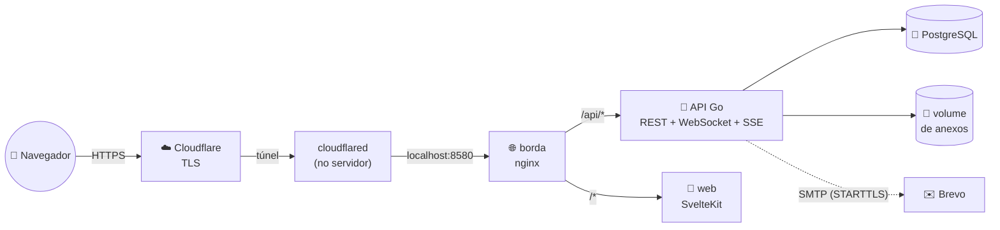
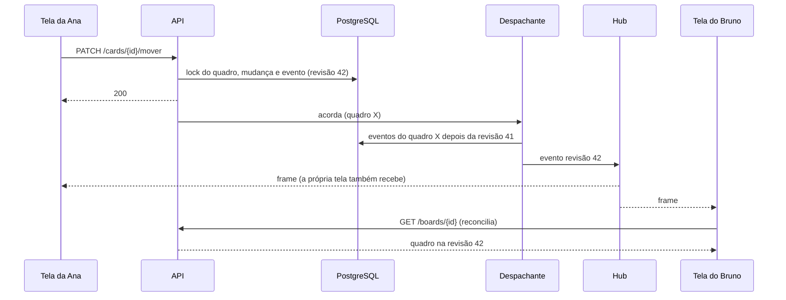
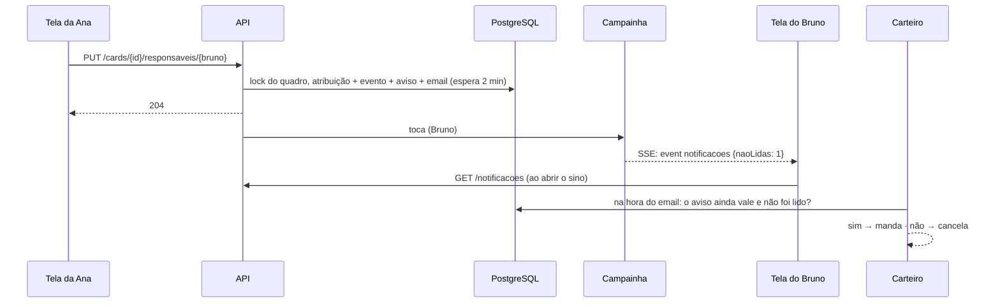
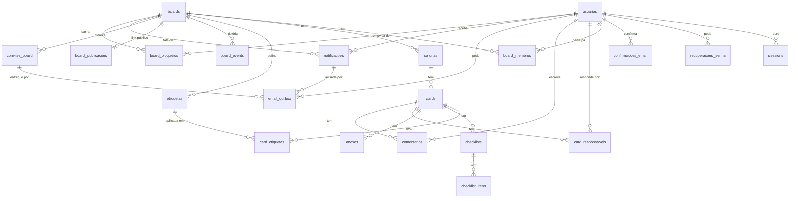

# 📐 Arquitetura


> **Em uma frase:** as decisões estruturais, o modelo de dados, o contrato
> HTTP e todas as rotas.
>
> **Documento técnico.** Se é a primeira vez no projeto, comece por
> [como-funciona.md](como-funciona.md), que explica a mesma coisa sem jargão, e
> veja as funcionalidades de ponta a ponta em
> [funcionalidades.md](funcionalidades.md). Este aqui é a referência das
> decisões estruturais, do modelo de dados e do contrato HTTP.

O documento descreve o sistema **como ele é hoje**. Quando uma decisão
substituiu outra, o motivo está registrado porque ele ainda restringe o que
pode mudar; a história de como se chegou aqui está em
[historico-do-projeto.md](historico-do-projeto.md).

---

## 🗺️ Visão geral



Uma API só, num processo só, com um hexágono no backend. O tempo real não é
um serviço à parte: o hub de WebSocket, o despachante de eventos, a campainha
das notificações, o vigia de prazos, a faxina e o worker de email são goroutines
da própria API (ver
[Trabalhos em segundo plano](#-trabalhos-em-segundo-plano)). O perfil de
produção é **uma instância**, sem alta disponibilidade, dimensionada para cerca
de 25 conexões simultâneas (até 10 pessoas editando) e quadros de até 20
colunas e 1.000 cards. Passar disso pede medição antes de mudar a arquitetura —
Redis, broker ou várias instâncias da API não entram sem um gargalo medido que
os justifique. A memória de cada serviço está em
[producao.md](producao.md#-dimensionamento).

Front e API compartilham a **mesma origem** (`/api` é um caminho, não um
domínio): é o que faz o cookie `__Host-` valer e a CSP ficar em
`connect-src 'self'`. A borda e o túnel estão em [producao.md](producao.md).

---

## 🧱 Camadas

### Backend (`backend/`)

| | Pasta | Responsabilidade |
|---|---|---|
| 🚀 | `cmd/api` | o `main` e a montagem da aplicação (`montagem.go`), usada também pelo teste de servidor |
| 🔧 | `cmd/manutencao` | o binário de manutenção do banco (`reparar-ordenacao`) |
| ⚙️ | `config/` | variáveis de ambiente, validação de produção, pool, servidor HTTP, roteador |
| 💎 | `internal/domain/` | regras puras: `board`, `coluna`, `card`, `ordem`, `membro`, `convite`, `etiqueta`, `checklist`, `anexo`, `comentario` (e as menções), `publicacao`, `evento`, `email`, `notificacao`, `usuario`, `session`, `cor` |
| 🧭 | `internal/usecase/board` | os casos de uso do quadro e as portas que eles exigem (`repositorio.go`, `eventos.go`, `notificacoes.go`), e o vigia de prazos |
| 🔔 | `internal/usecase/notificacao` | o sino de cada pessoa: listar, contar e marcar como lido |
| 🔐 | `internal/usecase/auth` | cadastro, login, logout, sessão |
| ✉️ | `internal/usecase/correio` | o worker que entrega o outbox de email |
| 🧹 | `internal/usecase/manutencao` | a faxina periódica e o coletor de arquivos |
| 🔌 | `internal/adapter/http` | handlers, DTOs (as únicas tags JSON), middlewares, o WebSocket e o SSE |
| 🐘 | `internal/adapter/repository` | todo o SQL, a unidade de trabalho e o instantâneo de leitura |
| 📡 | `internal/adapter/realtime` | o hub (salas por quadro), o despachante (entrega lendo o log) e a campainha (salas por pessoa, para o sino) |
| 📎 | `internal/adapter/armazem` | o disco dos anexos e o porteiro de espaço livre |
| ✉️ | `internal/adapter/email` | o redator (modelos versionados) e o cliente SMTP |
| 🔑 | `internal/adapter/security` | Argon2id e a cifra AES-GCM do outbox |
| 🛠️ | `internal/pkg` | limitador por chave, logging sanitizado, geração de token |

As dependências apontam para dentro. O domínio não importa nada de fora — nem
`net/http`, nem `encoding/json`, nem `pgx`. As **portas** são declaradas no
pacote que as consome (`usecase/board/repositorio.go`), e quem as implementa é o
adaptador: o caso de uso não sabe que existe Postgres, WebSocket ou SMTP.

### Frontend (`frontend/src/`)

| | Pasta | Responsabilidade |
|---|---|---|
| 🧭 | `routes/` | as telas: início, `cadastro`, `login`, `recuperar-senha`, `redefinir-senha/[token]`, `confirmar-email/[token]`, `painel`, `painel/quadros/[id]` (o quadro), `…/membros`, `…/historico`, `convite/[token]`, `publico/[token]`, `notificacoes/[id]` (o link do email de um aviso), `termos`, `privacidade` e o `+error.svelte` |
| 🔌 | `lib/api/` | o cliente HTTP e os tipos que espelham os DTOs do backend |
| 📡 | `lib/realtime/` | a conexão de WebSocket, a reconciliação por revisão e o stream (SSE) do sino |
| 🧩 | `lib/components/` | o card, a coluna, o modal do card, os diálogos, o sino e o campo de comentário com menções |
| 🗃️ | `lib/stores/` | sessão, tema e o sino |
| 📐 | `lib/*.ts` | funções puras com resultado visível: Markdown, filtro, frases da auditoria e do sino, menções, arrastar, paleta, máscara de email |

SPA sem SSR nas telas autenticadas (`ssr = false`): o cookie de sessão é
`HttpOnly`, e o servidor do SvelteKit nunca teria acesso a ele. A tela nunca
decide permissão — ela esconde o que vai ser recusado, e quem decide é sempre o
servidor.

---

## ⭐ As decisões centrais

Antes das decisões, as regras que valem para **toda** mudança — cada uma
explicada nas seções abaixo ou no documento indicado:

1. Conhecer um email nunca dá acesso a um quadro: o acesso nasce de uma sessão
   e de uma autorização comprovável — o link do convite aceito pela conta do
   email, ou o convite no painel de uma conta que **confirmou** o email.
2. Todo quadro tem ao menos um dono válido durante qualquer transição.
3. Uma mutação observável e o evento dela caem na mesma transação.
4. O cliente só confirma uma revisão que aplicou, ou que substituiu por um
   snapshot consistente.
5. Um arquivo só sai do disco quando a exclusão está registrada e existe backup
   externo posterior a ela.
6. O que vai para produção é a imagem do commit que foi testado.
7. Segredos, tokens, cookies, conteúdo de cards e emails completos não entram
   em log.
8. Mudança de schema que aperta segue expandir → preencher → contrair
   ([CLAUDE.md](../CLAUDE.md#migration-que-aperta-exige-dois-deploys)).
9. Nenhum fluxo de quadro depende de email para funcionar: sem SMTP, o convite
   sai com o link manual, e as notificações ficam só no sino.
10. Um aviso pessoal nasce no mesmo commit do que o causou; se ele ainda vale é
    lido do estado atual, nunca gravado.

### A mudança e o evento caem no mesmo commit

Toda mutação de quadro grava a mudança **e** o evento que a descreve
(`board_events`) na mesma transação (`EscritaAtomica`, implementada por
`adapter/repository.UnidadeDeTrabalho`). Sem isso, um processo que morresse
entre as duas escritas deixaria a mudança sem evento, e a tela de quem reconecta
passaria a discordar do banco em silêncio.

O evento é o **outbox** do tempo real: ninguém o publica direto. Quem termina a
mutação só acorda o despachante, que lê o log e entrega em ordem.

### A revisão do quadro e o lock

Cada quadro tem uma `revisao`, incrementada sob o lock da linha do quadro
(`UPDATE boards SET revisao = revisao + 1 … RETURNING`) no começo de toda
escrita. Duas consequências:

- **as mutações de um quadro são serializadas** — duas pessoas arrastando no
  mesmo quadro não intercalam escritas;
- **o evento recebe uma posição na história daquele quadro**, e é essa posição,
  e não o `seq` global, que o cliente usa como cursor. O `seq` é alocado antes
  do commit, e a ordem de alocação pode diferir da ordem de commit.

Esperar o lock tem teto (`ESPERA_LOCK_QUADRO_MS`); estourado, a API responde
**503** com `Retry-After`, em vez de segurar a requisição.

### O tempo real



- O **hub** (`adapter/realtime/hub`) mantém uma sala por quadro, em memória.
- O **despachante** entrega lendo o log, em ordem de revisão, com polling curto
  (`DESPACHANTE_INTERVALO_MS`) como rede para um aviso perdido.
- A tela **recarrega o quadro** ao receber um evento, em vez de aplicar a
  diferença: um caminho de aplicação por tipo de evento seria um lugar a mais
  para a tela discordar do banco. A revisão permite dispensar o GET quando o
  snapshot na tela já a cobre. Eventos próximos viram **uma recarga só**: a
  primeira rajada espera 150 ms e, sob mudança contínua, sai no máximo uma a
  cada 3 s — com card, membros e histórico abertos são até cinco GETs por lote,
  e isso mantém a aba abaixo do teto de 120 requisições por minuto da sessão. O
  preço é até 3 s de atraso visual num quadro que não para de mudar.
- A revisão só é **confirmada** depois de aplicados o quadro **e** o que estiver
  aberto por cima dele (o modal do card): confirmar é dizer "apliquei até aqui",
  e só um snapshot permite essa afirmação (`lib/realtime/reconciliacao.ts`).
- `quadro.apagado` é o único evento terminal: a tela fecha o socket e volta ao
  painel, sem buscar um snapshot que responderia 404.
- **Reconectar** é `GET /ws?board={id}&revisao={n}`: o servidor assina a sala
  **antes** de repor o intervalo, e por isso nada se perde entre a história e o
  ao vivo (o preço é algum evento repetido, que a revisão deduplica). Intervalo
  acima de 200 eventos vira `recarregue.tudo`.
- A conexão longa tem ping a cada 30 s, prazo de escrita, teto de frame e de
  fila, e **revalida a sessão** a cada 30 s: o logout derruba o socket.
- **Presença** e "quem está editando esta coluna" são estado efêmero do hub —
  não têm tabela e morrem com o processo.

### As notificações: gravadas no banco, avisadas por SSE

O sino de cada pessoa junta quatro avisos: o **convite** para um quadro, o card
de que ela passou a ser **responsável**, a **menção** num comentário e o
**prazo** de um card dela chegando.



- **O aviso é gravado**, na mesma transação do que o causou
  (`usecase/board/notificacoes.go`): a atribuição que comita leva o aviso junto,
  e a que cai no rollback não deixa aviso nem email para trás. O prazo, que
  nenhuma ação de pessoa causa, é avisado pelo **vigia de prazos**, que olha o
  relógio em segundo plano (`usecase/board/prazos.go`).
- **O SSE só toca a campainha.** O stream (`GET /notificacoes/eventos`) carrega
  a contagem, não o aviso; a tela relê a lista quando quer mostrá-la. Um toque
  perdido — a aba fechada, a conexão caída — não perde nada. O porquê de SSE, e
  não o WebSocket do quadro, está em
  [tecnologias.md](tecnologias.md#sse--o-sino-das-notificações).
- **Se o aviso ainda vale é calculado na leitura**, sobre o estado atual
  (`adapter/repository/notificacao_postgres.go`): a atribuição desfeita, o prazo
  trocado, o convite aceito, recusado, revogado ou vencido. Uma marca gravada de
  "não vale mais" teria de ser escrita por cada caminho que desfaz alguma coisa,
  e o caminho esquecido viraria aviso falso. As duas exceções são escritas, e
  por um motivo: a menção retirada do comentário apaga o aviso (não há como
  calcular, em SQL, se um texto ainda menciona alguém), e sair do quadro apaga os
  avisos dele, como já levava as atribuições.
- **O email confere o aviso na hora de sair**, e não é cancelado por quem desfaz
  o fato. Ele espera dois minutos (quem está com o sistema aberto lê no sino, e o
  aviso lido cancela o email); na saída, o worker pergunta se o aviso ainda vale
  e não foi lido — e cancela se não. O link do email aponta para o AVISO
  (`/notificacoes/{id}`), e não para o card: é a página dele que diz "não vale
  mais" quando for o caso.
- **Quem vê o quê**: o aviso de convite só aparece para a conta com o email
  confirmado e igual ao do convite, a mesma regra do painel; os demais só para
  quem ainda participa do quadro.

### A ordem é uma chave de texto

Colunas e cards guardam uma `chave` textual (`domain/ordem`): mover um card
escreve **uma linha**, com uma chave entre as dos vizinhos (entre `"b"` e `"c"`
cabe `"bn"`). Uma posição numérica obrigaria a renumerar a lista inteira, e
duas pessoas arrastando no mesmo quadro entrariam em corrida garantida.

- A primeira versão usou `float`, que esgota a mantissa em **52 inserções**
  seguidas no mesmo ponto. A chave textual cresce ~0,27 caractere por movimento
  e só esbarra no `VARCHAR(200)` perto de **750** reordenações no mesmo lugar —
  e o domínio conhece esse teto e responde **409** antes do banco. Se ele
  chegar, a saída **não** é uma coluna mais larga, que só adia o mesmo problema:
  é redistribuir as chaves daquela lista (`cmd/manutencao reparar-ordenacao`),
  aceitando de propósito a reescrita em massa que o esquema evita no caso comum.
- **A API recebe os vizinhos (`anteriorId`, `proximoId`), nunca a chave.** A
  cópia na tela pode estar velha, e chave vinda do cliente é entrada do
  usuário. Vizinhos fora de ordem respondem **409**.
- A chave nova é **sorteada** dentro da folga: duas pessoas soltando no mesmo
  ponto ao mesmo tempo não calculam a mesma chave.
- Nenhuma chave termina no menor caractere — senão inserir no topo viraria
  impossível.
- A comparação é **byte a byte** (`COLLATE "C"`), e `UNIQUE (coluna_id, chave)`
  e `UNIQUE (board_id, chave)` (`V18`) garantem que não há empate.
- Etiquetas e checklists ainda usam `posicao` em float: só acrescentam no fim,
  e o limite da mantissa não é alcançável sem inserir no meio.

### Bloqueio otimista no card

Cada card tem `version`, que sobe a cada escrita. A tela devolve a versão que
estava mostrando; se o banco já foi além, a resposta é **409**, e a tela avisa
"alguém alterou este card" mantendo o texto digitado. É o *lost update*
clássico, e o isolamento padrão do Postgres (`READ COMMITTED`) não protege contra
ele — os dois `UPDATE`s são válidos isoladamente. São duas redes: a
conferência no caso de uso pega o conflito lento (abriu, saiu, salvou meia hora
depois) e o `WHERE version = $n` do SQL pega o simultâneo. **Mover não confere
versão**: é posicional, e não há texto de ninguém para perder.

### A leitura é um instantâneo

`GET /boards/{id}`, `GET /cards/{id}` e o link público leem dentro de uma
transação `REPEATABLE READ READ ONLY` (`adapter/repository.Instantaneo`). Sem
isso, as consultas que montam a tela enxergariam instantes diferentes do banco,
e a resposta sairia carimbada com uma revisão que não descreve nenhum estado
real.

### 404, e não 403, para quem não participa

Quem não participa de um quadro recebe **404** — um 403 confirmaria que o
quadro existe. O 403 fica para quem **é** membro e esbarra no próprio papel.
A tradução vale em cadeia: o card de um quadro alheio responde "card não
encontrado". A rota nunca informa o quadro: card, coluna, etiqueta e anexo são
identificados por si, e o servidor descobre o quadro sozinho (card → coluna →
quadro).

### O que sai para fora também tem outbox

- **Email** (`email_outbox`, `V19`): a mensagem do convite — do link de
  recuperação de senha, ou de uma notificação — entra na mesma transação do que
  a pede, cifrada (AES-256-GCM), e um worker a entrega depois do commit, com
  retentativa. O email de notificação espera dois minutos e é conferido na
  saída (ver [As notificações](#as-notificações-gravadas-no-banco-avisadas-por-sse)). Detalhes em
  [tecnologias.md](tecnologias.md#email-outbox-smtp-e-mailpit) e a operação em
  [producao.md](producao.md#-email-dos-convites).
- **Arquivo apagado** (`arquivo_exclusoes`, `V17`): apagar um card apaga a linha
  do anexo, mas os bytes só saem do disco quando um backup externo comprova que a
  exclusão está coberta. Enquanto essa prova não existe (etapa A6), o coletor
  opera em **fail-closed**: acumula e não remove nada.

---

## 🗄️ Modelo de dados



<details>
<summary>Em árvore, se preferir</summary>

```
usuarios ──┬── sessions
           ├── recuperacoes_senha  (o hash do link de senha nova)
           ├── confirmacoes_email  (o hash do link de confirmação)
           ├── board_membros ◄── boards
           ├── card_responsaveis ◄── cards
           ├── comentarios ◄── cards
           ├── notificacoes        (o aviso pessoal; aponta para quadro, card,
           │                        comentário ou convite)
           └── email_outbox ◄── convites_board, notificacoes

boards ──┬── board_membros        (papel: dono, editor, leitor)
         ├── board_bloqueios       (quem o dono tirou: não volta pelo domínio)
         ├── colunas ── cards ──┬── card_etiquetas ──► etiquetas
         │                      ├── checklists ── checklist_itens
         │                      ├── anexos
         │                      ├── card_responsaveis
         │                      └── comentarios
         ├── etiquetas
         ├── board_events          (o log: tipo, payload, revisão)
         ├── board_publicacoes     (o token do link público)
         ├── notificacoes          (pela retenção: boards.retencao_notificacoes_dias)
         └── convites_board ── email_outbox

arquivo_exclusoes                  (sem FK, de propósito: sobrevive ao CASCADE)
```

</details>

Regras que o schema carrega:

- **Apagar é em cascata**: quadro leva colunas, colunas levam cards, cards levam
  etiquetas aplicadas, checklists, responsáveis, comentários e anexos. O log de
  eventos vai junto com o quadro.
- **Tokens só em hash**: `sessions.token_hash`, `convites_board.token_hash`,
  `recuperacoes_senha.token_hash` e `confirmacoes_email.token_hash` guardam o
  SHA-256 — um vazamento do banco não
  devolve sessão, convite nem link de senha nova utilizável. A exceção é `board_publicacoes.token`, em claro porque o dono
  precisa ver o link de novo; ele só dá **leitura** de um recorte do quadro.
- **O convite vira histórico**: aceitar, revogar e recusar **marcam**
  (`aceito_em`, `revogado_em`, `recusado_em`) em vez de apagar — a recusa grava
  também `revogado_em`, que é o que a tira das pendências; a faxina remove o terminal depois de 90
  dias. A unicidade de "um convite em aberto por email por quadro" é um índice
  parcial.
- **O log é append-only**: o evento guarda **nomes**, além de ids, porque
  registra o que era verdade no momento — renomear a coluna depois não pode
  reescrever a frase de ontem.
- **`arquivo_exclusoes` não tem FK**: ela existe para sobreviver ao `CASCADE`
  que apaga a linha do anexo.
- **O aviso some com o que ele aponta**: `notificacoes` tem `CASCADE` para o
  quadro, o card, o comentário e o convite — um aviso sobre um card apagado não
  tem para onde levar ninguém, e o de um comentário apagado guardaria a lembrança
  de um texto retirado. O email de um aviso vai junto (`email_outbox.notificacao_id`,
  também `CASCADE`). A chave `notificacoes.chave` é única: o mesmo prazo visto
  por duas passadas do vigia, ou o mesmo convite reenviado, não viram dois avisos.
- **A porta do domínio são duas colunas que andam juntas**:
  `boards.dominio_acesso` e `boards.dominio_papel`, nulas quando o quadro está
  fechado. O domínio gravado é sempre o do email confirmado de quem abriu —
  derivado pelo domínio (`internal/domain/dominio`), nunca recebido como texto.
  `board_bloqueios` guarda quem o dono tirou do quadro, e só um convite aceito
  apaga a linha.
- **Sem `DEFAULT` nem `CHECK` de regra de negócio**, e migration não escreve
  dado — as regras estão no [CLAUDE.md](../CLAUDE.md#migrations-banco-de-dados).
  A sequência vigente das migrations, e o porquê de cada uma, está em
  [backend/migrations/README.md](../backend/migrations/README.md).

---

## ⚙️ Casos de uso

| | Caso de uso | Responsabilidade |
|---|---|---|
| 🔐 | `CadastrarUseCase`, `LoginUseCase`, `LogoutUseCase` | conta e sessão (conta e primeira sessão no mesmo commit) |
| 🔐 | `ValidarSessaoUseCase`, `PerfilUseCase` | a sessão de cada requisição e o `/auth/me` |
| 📬 | `ConfirmarEmailUseCase` | mandar o link de confirmação (logo depois do cadastro, ou de novo pelo painel, com teto) e confirmar a conta com ele |
| 🔑 | `RecuperarSenhaUseCase` | pedir o link (com teto, sem revelar quem tem conta), conferi-lo e trocar a senha — encerrando os links e as sessões da conta no mesmo commit |
| 🗂️ | `QuadroUseCase` | listar, criar, detalhar (no instantâneo), renomear, trocar o fundo e a retenção das notificações, apagar |
| 🧱 | `ColunaUseCase` | criar, renomear (título e cor), mover pelos vizinhos, apagar |
| 🃏 | `CardUseCase` | criar, editar (com `version`), mover pelos vizinhos, prazo, detalhar, apagar |
| 🏷️ | `EtiquetaUseCase` | etiquetas do quadro e a aplicação nos cards |
| ☑️ | `ChecklistUseCase` | checklists e itens |
| 📎 | `AnexoUseCase` | link e arquivo, com as cotas conferidas na transação; download |
| 🙋 | `ResponsavelUseCase` | quem responde pelo card (só quem participa), avisando quem passou a responder |
| 💬 | `ComentarioUseCase` | a conversa do card, com as regras de quem edita e apaga, e o aviso de quem foi mencionado |
| 👥 | `MembroUseCase` | membros, papéis, convites (por email), aceite, reenvio, revogação; os convites da conta no painel — listar, aceitar e recusar, só com o email confirmado |
| 🔗 | `PublicacaoUseCase` | o link público: ligar, consultar, revogar, ler a projeção |
| 📜 | `AtividadeUseCase` | o histórico do card e do quadro (read model sobre o log) |
| 🔧 | `ReparoDeOrdenacao` | o comando `reparar-ordenacao`, um quadro por transação |
| 🔔 | `ucnotificacao.UseCase` | o sino: listar (por cursor), contar as não lidas, detalhar, marcar como lida (uma ou todas) |
| ⏰ | `VigiaDePrazos` | o aviso da véspera para quem responde por um card com prazo |

Cada caso de uso confere o acesso **antes** de ler e de novo **sob o lock**,
dentro da transação: o papel lido antes pode ter mudado enquanto a requisição
esperava a vez.

---

## 🔁 Trabalhos em segundo plano

Todos rodam dentro da API, como goroutines, e param quando o processo recebe
`SIGTERM`.

| | Trabalho | O que faz | Ritmo |
|---|---|---|---|
| 📡 | despachante | entrega os eventos lendo `board_events`, em ordem de revisão | acordado no commit; polling de 1 s |
| ✉️ | carteiro | entrega o `email_outbox`, com retentativa e desistência em 5xx; confere o aviso de cada email de notificação antes de mandar | acordado no commit; olha a fila a cada 5 s |
| ⏰ | vigia de prazos | avisa quem responde por um card cujo prazo cai nas próximas 24 h, uma vez por prazo | acordado ao marcar prazo e ao atribuir; olha a cada 10 min |
| 🧹 | faxina | apaga sessões vencidas, links de recuperação e de confirmação vencidos, convites terminais antigos e as notificações além da retenção de cada quadro, purga o email vencido e roda o coletor | a cada 60 min, com orçamento de tempo |
| 🗑️ | coletor | remove do disco os anexos apagados **já cobertos por backup** | dentro da faxina; hoje não remove nada (fail-closed) |

---

## 🔌 Contrato HTTP

### Convenções

- **JSON** nos dois sentidos; erro é sempre `{"erro": "mensagem"}`, em português
  e pensada para a tela mostrar como veio.
- **Códigos que importam**: `400` dado inválido · `401` sem sessão · `403`
  membro sem o papel necessário · `404` inexistente **ou** sem acesso ·
  `409` conflito (versão defasada, vizinhos fora de ordem, duplicidade) ·
  `413` corpo grande demais · `415` tipo de anexo fora da lista · `422` regra de
  negócio (cota, teto, responsável de fora) · `429` teto de requisições, com
  `Retry-After` · `503` lock do quadro ocupado ou prazo estourado · `507` disco
  sem margem para escrever.
- **O prefixo `/api` é da borda**, e não da API: em produção a tela chama
  `/api/boards`, e o nginx repassa `/boards` — a mesma rota que, em
  desenvolvimento, a tela chama direto em `localhost:8080`. As rotas abaixo vêm
  sem o prefixo.
- **IDs da URL são validados** antes do caso de uso (`middleware.IDsDaURLValidos`):
  um parâmetro terminado em `ID` que não seja UUID responde **400**, sem chegar
  ao banco — a regra vale sozinha para toda rota nova que siga a convenção.
- **Tetos do corpo**: 1 MiB para JSON, 11 MiB para o upload de anexo.
- **Prazos**: 10 s por requisição e 120 s para upload; estourado, `503`.
- **Respostas autenticadas e as que carregam segredo** saem com
  `Cache-Control: no-store`.
- Os DTOs (`adapter/http/dto`) são a **única** parte do backend com tag JSON.
  `frontend/src/lib/api/*.ts` é o espelho deles e muda junto.

### Tetos de requisição

| Teto | Padrão | Chave |
|---|---|---|
| cadastro e pedido de recuperação de senha | 5 / min | IP |
| login e troca de senha pelo link | 10 / min | IP |
| login por conta | 5 falhas / 5 min | email |
| rotas autenticadas | 120 / min | sessão |
| rotas públicas (convite, link público, conferir o link de senha nova, confirmar o email) | 30 / min | IP |
| cookies de sessão desconhecidos | 30 | IP, conferido antes do banco |
| WebSocket | 5 conexões por conta, 100 no total, 10 handshakes / min por IP | — |
| stream das notificações (SSE) | 10 por conta, 200 no total, 60 aberturas / min por IP | — |
| emails de notificação | 20 por pessoa que recebe, em 24 h (além disso, só o sino) | — |

Em produção nenhum teto pode estar em zero (`config.Validar`). Em
desenvolvimento eles ficam frouxos, porque a suíte E2E dispara centenas de
requisições em segundos. O IP que conta é o do visitante, lido do `X-Real-IP`
**só** quando quem entregou a conexão está em `PROXIES_CONFIAVEIS`.

### Sessão

| | Como |
|---|---|
| token | 256 bits de `crypto/rand`; o banco guarda só o SHA-256 |
| validade | 7 dias a partir do login, fixa |
| cookie | `HttpOnly`, `SameSite=Lax`; em produção `Secure` e o prefixo `__Host-` (exige `Path=/` e nenhum `Domain`) |
| senha | Argon2id; mínimo de 15 caracteres; recusa as senhas de uma lista local de comuns |
| login | mensagem genérica, e o mesmo custo de CPU com email inexistente — o tempo de resposta não revela quem tem conta |

### Rotas

| Método | Rota | O que faz |
|---|---|---|
| `GET` | `/health` | Liveness: o processo está no ar. Não toca em dependência nenhuma. |
| `GET` | `/ready` | Readiness, com o motivo separado: **503** se o banco estiver fora (sem ele nem leitura existe) e **200 com `escrita: false`** quando o disco está sem margem — aí a leitura continua e só a escrita é recusada. Traz `discoLivreBytes`, `discoLivrePorCem` e `tempoReal` (atraso do despachante, conexões derrubadas por lentidão e quantos streams de notificação estão abertos). |
| `POST` | `/auth/cadastro` | Cria a conta e já abre a sessão (201 + cookie). Conta e sessão entram no **mesmo commit**. **409** se o email já existir; **400** para senha com menos de 15 caracteres ou presente na lista local de senhas comuns. |
| `POST` | `/auth/login` | Autentica e abre a sessão (200 + cookie). 401 genérico; 429 no teto por conta. |
| `POST` | `/auth/logout` | Encerra a sessão no servidor e apaga o cookie (204, sempre). |
| `POST` | `/auth/recuperacao` | O "esqueci minha senha": manda o link por email. **202** com a **mesma** mensagem para email com conta, sem conta e com o teto de 3 pedidos por hora atingido — a diferença revelaria quem tem conta. **400** só para email malformado. |
| `GET` | `/auth/recuperacao/{token}` | Confere o link: `emailMascarado` e `expiraEm`. **404** para link inexistente, vencido ou já usado — os três iguais. |
| `POST` | `/auth/recuperacao/{token}` | Troca a senha e já abre a sessão (200 + cookie). No mesmo commit, encerra os outros links abertos da conta e apaga **todas** as sessões dela. **400** para senha que o cadastro recusaria — sem gastar o link; **404** como acima. |
| `POST` | `/auth/confirmacao/{token}` | Confirma o email da conta do link (204), **sem sessão** — quem abre o link prova a caixa de entrada. **404** para link inexistente, vencido ou já usado. |
| `GET` | `/auth/me` | Devolve a conta autenticada. **401** sem sessão válida; **429** com `Retry-After` quando o mesmo IP apresenta cookies desconhecidos demais — o teto é conferido **antes** da consulta ao banco, e vale para toda rota autenticada. |
| `GET` | `/convites/{token}` | Detalhes do convite, **sem sessão** — é o que a tela do link mostra: quadro, papel, quem convidou e até quando vale (`expiraEm`). O email vem **mascarado** (`a***@exemplo.com`) no campo `emailMascarado`: quem tem o link não é necessariamente quem foi convidado. Responde `Cache-Control: no-store` e `Referrer-Policy: no-referrer`. |
| `GET` | `/publico/{token}` | O quadro de um link de acompanhamento, **sem sessão**: colunas, cards, descrições, etiquetas, prazos e checklists. Sem responsáveis, comentários, anexos, histórico nem ids. **404** para token inventado, revogado ou de quadro apagado — os três iguais. Responde `Cache-Control: no-store` e `X-Robots-Tag: noindex`. |

As demais exigem sessão e têm teto de requisições por sessão.

| Método | Rota | O que faz |
|---|---|---|
| `GET`/`POST` | `/boards` | Lista os quadros de que você participa (com o seu papel e o nome do `dono`) e cria um novo. O painel separa por aí os seus dos compartilhados com você. **422** quando a conta já é dona de 100 quadros (o teto do plano gratuito). |
| `GET` | `/boards/{id}` | O quadro com colunas e cards, em ordem, numa requisição só — lido sobre **um único instantâneo** do banco (`REPEATABLE READ`). Traz `revisao`, que é o cursor que a tela devolve ao WebSocket. |
| `PATCH`/`DELETE` | `/boards/{id}` | Renomeia ou apaga o quadro. Só o dono. |
| `PATCH` | `/boards/{id}/fundo` | Troca o fundo do quadro. Só o dono. |
| `PATCH` | `/boards/{id}/retencao-notificacoes` | Define por quantos dias as notificações **lidas** do quadro ficam guardadas (`{"dias": 7}`). Só o dono — **403** para editor e leitor; **400** fora de 1 a 365. Fica no histórico do quadro. `GET /boards/{id}` devolve o valor em `retencaoNotificacoesDias`, já resolvido para o padrão (30). |
| `GET` | `/boards/{id}/publicacao` | O estado do link público, com a URL. Só o dono — **403** para editor e leitor, porque o token é o segredo do link. |
| `PUT` | `/boards/{id}/publicacao` | Liga o link público e devolve a URL. Só o dono. Idempotente: repetir devolve o **mesmo** link. |
| `DELETE` | `/boards/{id}/publicacao` | Revoga o link (204, mesmo que já não houvesse). O endereço morre na hora, e publicar de novo gera um token **diferente**. |
| `POST` | `/boards/{id}/colunas` | Cria uma coluna no fim do quadro (201). |
| `PATCH`/`DELETE` | `/colunas/{id}` | Renomeia (título e cor) ou apaga a coluna e os cards dela. |
| `PATCH` | `/colunas/{id}/mover` | Reordena a coluna no quadro, **pelos vizinhos**. |
| `POST` | `/colunas/{id}/cards` | Cria um card no fim da coluna (201). |
| `GET` | `/cards/{id}` | O card com responsáveis, comentários, etiquetas, checklists e anexos — lidos no mesmo instantâneo `REPEATABLE READ`. Traz `revisao`, usada para o modal participar da confirmação do cursor do quadro. |
| `PATCH`/`DELETE` | `/cards/{id}` | Edita título, descrição e cor, ou apaga. **409** se `version` estiver defasada. |
| `PATCH` | `/cards/{id}/mover` | Move o card. Recebe os **vizinhos**, não a ordem. **409** se eles vierem fora de ordem (a tela estava velha) ou se a lista já foi reordenada vezes demais naquele ponto. |
| `PATCH` | `/cards/{id}/prazo` | Marca a data de entrega; `null` limpa. |
| `GET`/`POST` | `/boards/{id}/membros` | Quem participa (com os convites pendentes e o estado do email de cada um, para o dono) e convida informando o email. O convite vai por **email** e a resposta traz também o `link`, para o dono mandar por outro meio; `entrega` diz como ele chega: `email` (na fila), `manual` (envio desligado) ou `cota` (teto de 30 emails de convite por dia atingido — só o link vale). Conhecer um email não põe ninguém no quadro. **409** se a pessoa já participa ou já tem convite pendente; **422** com 50 convites em aberto no quadro. |
| `PATCH`/`DELETE` | `/boards/{id}/membros/{usuarioId}` | Troca o papel ou remove do quadro. Só o dono. Quem é removido por outra pessoa fica bloqueado: não volta pelo domínio, só por um convite aceito. |
| `GET` | `/boards/{id}/dominio` | A porta do domínio: `dominio` e `papel` abertos (vazios, fechada) e `disponivel`, o domínio que o dono pode abrir — o do email confirmado dele. Vazio, `impedimento` diz por quê: `email_nao_confirmado` ou `email_pessoal`. Só o dono — **403** para editor e leitor. |
| `PUT` | `/boards/{id}/dominio` | Abre o quadro a quem tem email confirmado do domínio do dono (`{"papel": "editor"}`; o domínio **não** vem no corpo). Abrir de novo troca o papel de quem ainda vai entrar. **422** para email não confirmado ou de provedor pessoal (Gmail, Outlook…); **400** para papel que não seja `editor` ou `leitor`. Fica no histórico. |
| `DELETE` | `/boards/{id}/dominio` | Fecha a porta (204): quem não entrou deixa de ver o quadro, e quem entrou continua. Fechar o que já está fechado não grava nada. |
| `POST` | `/boards/{id}/entrar` | Entra no quadro aberto ao domínio do email da conta, com o papel escolhido pelo dono, e devolve o quadro. A única rota de `/boards/{id}` que não exige participar. **404** para tudo o que não dá direito de entrar — porta fechada, outro domínio, email não confirmado, pessoa que o dono tirou —, como o quadro de que não se participa; **422** com 100 participantes. Entrar de novo devolve o papel atual sem gravar nada. |
| `DELETE` | `/boards/{id}/convites/{conviteId}` | Revoga um convite, invalidando o link (204), e tira da fila o email que ainda não saiu. **Marca** como revogado em vez de apagar — a linha ainda responde "quem convidou quem, e quando". **404** para convite já aceito, já revogado ou inexistente: os três iguais. |
| `POST` | `/boards/{id}/convites/{conviteId}/reenviar` | Dá ao convite um link novo, com a validade inteira de novo (também ao vencido), e o manda outra vez por email. O link anterior — inclusive o do email anterior — deixa de valer. Responde como o convidar (`link`, `entrega`). **429** com `Retry-After` se o último email desse convite saiu há menos de 2 minutos; **404** para convite já aceito, revogado, de outro quadro ou de quem não administra. |
| `POST` | `/auth/confirmacao` | Reenvia o link de confirmação para a conta logada (202). A mesma resposta com o teto de 3 por hora atingido e para conta já confirmada. |
| `GET` | `/meu-dominio/quadros` | Os quadros abertos ao domínio do email da conta de que ela ainda não participa nem foi tirada: `id`, `titulo`, `dono`, `papel` (com que entra) e `participantes`. Lista vazia — e não erro — para conta sem email confirmado ou com email pessoal. |
| `GET` | `/meus-convites` | Os convites em aberto e válidos para o email da conta, de qualquer quadro: `quadro`, `convidadoPor`, `papel`, `expiraEm`. **403** para conta sem email confirmado. |
| `POST` | `/meus-convites/{conviteId}/aceitar` | Aceita pelo painel e devolve o quadro — o mesmo aceite do link, com a confirmação de email no lugar do token. **403** sem email confirmado; **404** para convite de outro email, vencido ou já resolvido. |
| `POST` | `/meus-convites/{conviteId}/recusar` | Recusa (204): encerra o convite e o link do email, tira da fila o email que não saiu e registra `convite.recusado` no histórico do quadro. Mesmos códigos do aceite. |
| `POST` | `/convites/{token}/aceitar` | Aceita o convite e entra no quadro, no **mesmo commit**. **403** quando a sessão é de outro email — e o convite **não** é consumido. **404** para token inválido, vencido ou já usado, inclusive quando outra requisição venceu a corrida. **422** com 100 participantes no quadro. Desfaz o bloqueio de quem tinha sido tirado. |
| `GET`/`POST` | `/boards/{id}/etiquetas` | Lista e cria as etiquetas do quadro. |
| `PATCH`/`DELETE` | `/etiquetas/{id}` | Edita nome e cor, ou apaga (some de todos os cards). |
| `PUT`/`DELETE` | `/cards/{id}/etiquetas/{etiquetaId}` | Aplica e tira a etiqueta do card. |
| `PUT`/`DELETE` | `/cards/{id}/responsaveis/{usuarioId}` | Marca e desmarca quem responde pelo card. **422** se a pessoa não participa do quadro. Marcar avisa a pessoa (sino e email) — menos quem marca a si mesmo, quem já respondia e quem ainda não leu o aviso da mesma atribuição. Marcar de novo quem já responde não é erro. |
| `GET` | `/cards/{id}/atividade` | O histórico do card: o que aconteceu, quem fez e quando. Read model sobre o log de eventos. |
| `GET` | `/boards/{id}/atividade` | O histórico do quadro: tudo o que aconteceu — card, coluna, etiqueta, anexo, checklist, responsável, comentário, participação —, do mais recente para o mais antigo. Qualquer membro lê. Parâmetros opcionais: `filtro=movimentacoes\|tudo` (padrão `movimentacoes`), `autor={usuarioId}` e `antesDe={seq}` — o cursor da página seguinte, e não um número de página. Devolve `temMais` para a tela não oferecer um "carregar mais" vazio. |
| `GET`/`POST` | `/cards/{id}/comentarios` | A conversa do card, do mais antigo para o mais novo, e escrever nela. Basta participar — comentar não exige papel de edição. Quem o texto chama com `@Nome Completo` (ou `@PrimeiroNome`, quando só uma pessoa do quadro o tem) é avisado. |
| `PATCH`/`DELETE` | `/comentarios/{id}` | Edita ou apaga. **403** ao editar o de outra pessoa: só o autor edita. Apagar, o autor no próprio e o dono em qualquer um. Editar acompanha as menções: quem deixou de ser chamado perde o aviso, quem passou a ser chamado ganha um. |
| `POST` | `/cards/{id}/checklists` | Cria uma checklist no card. |
| `PATCH`/`DELETE` | `/checklists/{id}` | Renomeia ou apaga (os itens vão junto). |
| `POST` | `/checklists/{id}/itens` | Cria uma linha. |
| `PATCH`/`DELETE` | `/itens/{id}` | Marca, renomeia ou apaga a linha. |
| `POST` | `/cards/{id}/anexos/link` | Anexa uma URL. **422** quando o card já tem 20 anexos. Link não consome cota de disco. |
| `POST` | `/cards/{id}/anexos/arquivo` | Envia um arquivo (multipart, até 10 MB). **413** para arquivo acima do limite individual; **422** quando o card já tem 20 anexos ou quando o quadro atingiu 1 GiB de arquivos. As duas cotas são conferidas **dentro da transação**, sob o lock do quadro — dois envios simultâneos não passam os dois. |
| `GET`/`DELETE` | `/anexos/{id}` | Baixa ou apaga o anexo. |
| `GET` | `/ws?board={id}&revisao={n}` | Abre o WebSocket do quadro e repõe tudo após a última revisão que a tela confirmou como aplicada. O `desde={seq}` do protocolo anterior é ignorado: a conexão vale como a primeira. O handshake tem prazo e limites próprios; depois do `101`, a conexão longa usa ping, teto de frame/fila e revalidação periódica. |
| `GET` | `/notificacoes` | O sino: os avisos visíveis da pessoa, do mais novo para o mais antigo, 30 por página, e `naoLidas` da mesma leitura. Cada aviso traz `tipo` (`convite`, `atribuicao`, `mencao`, `prazo`), os títulos de agora, `lida` e `situacao` (`vigente`, `encerrada` ou o desfecho do convite). `antesDe={id}` pede a página seguinte, e `temMais` diz se há uma; **400** para um `antesDe` que não é id. |
| `GET` | `/notificacoes/{id}` | Um aviso da pessoa — é o que a página do link do email consulta. **404** para aviso de outra pessoa, de quadro de que ela já não participa, ou que não existe mais: os três iguais. |
| `POST` | `/notificacoes/{id}/lida` | Marca o aviso como lido (204) e cancela o email dele que ainda não saiu; marcar de novo não é erro. Toca a campainha das outras abas da pessoa. **404** como acima. |
| `POST` | `/notificacoes/lidas` | Marca todos os avisos não lidos da pessoa (204), cancelando os emails que ainda não saíram. |
| `GET` | `/notificacoes/eventos` | O stream do sino (**SSE**, `text/event-stream`): `event: notificacoes` com `{"versao":1,"naoLidas":N}` na abertura, a cada toque da campainha e quando a contagem muda sozinha (um convite que venceu); um comentário de batimento a cada 25 s; e `event: encerrada` com o `motivo` (`sessao` ou `servidor`) antes de fechar. Fica fora do teto de requisições por sessão, como o `/ws`, com tetos próprios (**503** com `Retry-After` ao passar do de conexões; **429** no de aberturas por IP). Revalida a sessão a cada 30 s. |

Toda rota nova entra nesta tabela, com os códigos de erro que importam para quem
chama — a regra está no [CLAUDE.md](../CLAUDE.md#o-que-muda-junto-com-o-código).

---

## 🔤 Vocabulário

Conceitos de negócio em português, sem acento nos identificadores:

| Conceito | Go | Banco | JSON |
|---|---|---|---|
| Quadro | `board.Board` | `boards` | o objeto de `GET /boards/{id}`; `boards` na listagem |
| Coluna | `coluna.Coluna` | `colunas` | `colunas` |
| Card | `card.Card` | `cards` | `cards` |
| Membro | `membro.Membro` | `board_membros` | `membros` |
| Papel | `membro.Papel` | `board_membros.papel` | `papel` (`dono`, `editor`, `leitor`) |
| Convite | `convite.Convite` | `convites_board` | `convite`, `convites` |
| Recuperação de senha | `recuperacao.Recuperacao` | `recuperacoes_senha` | `emailMascarado`, `expiraEm` |
| Confirmação de email | `confirmacao.Confirmacao` | `confirmacoes_email`, `usuarios.email_confirmado_em` | `emailConfirmado` (em `/auth/me`) |
| Convite recebido | `board.ConviteRecebido` | `convites_board` | `convites` de `GET /meus-convites` |
| Etiqueta | `etiqueta.Etiqueta` | `etiquetas`, `card_etiquetas` | `etiquetas` (do quadro), `etiquetas` do card (só os ids) |
| Checklist | `checklist.Checklist` | `checklists`, `checklist_itens` | `checklists`, `itens`; no card, o progresso em `checklist` |
| Anexo | `anexo.Anexo` | `anexos` | `anexos`; no card, `qtdAnexos` |
| Comentário | `comentario.Comentario` | `comentarios` | `comentarios`; no card, `qtdComentarios` |
| Responsável | `ucboard.Responsavel` | `card_responsaveis` | `responsaveis` |
| Evento | `evento.Evento` | `board_events` | no WebSocket: `tipo`, `revisao`, `dados`; no histórico: `atividade` |
| Link público | `publicacao.Publicacao` | `board_publicacoes` | `publicado`, `url` |
| Envio de email | `email.Envio` | `email_outbox` | `entrega` (no convite) |
| Notificação (aviso) | `notificacao.Notificacao` | `notificacoes` | `notificacoes` de `GET /notificacoes`; `naoLidas` no stream |
| Retenção das notificações | `board.Board.RetencaoNotificacoesDias` | `boards.retencao_notificacoes_dias` | `retencaoNotificacoesDias` |
| Menção | `comentario.Mencoes` | — (lida do texto) | — |

Termos técnicos universais ficam em inglês: HTTP, JSON, handler, middleware,
repository, adapter, worker, token, hash, outbox. Comentários e godoc em
português.

---

## 🧪 Testes

As camadas, o que cada uma cobre e a política de testes estão em
[testes.md](testes.md). Em resumo: E2E (Playwright) para o que passa pela tela,
integração contra o PostgreSQL de verdade (Testcontainers) para o resto do
backend, e teste sem Docker só para função pura com resultado visível e para os
guarda-corpos estruturais.
