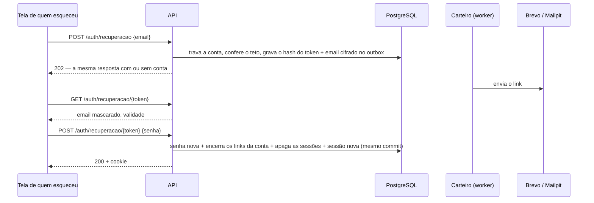
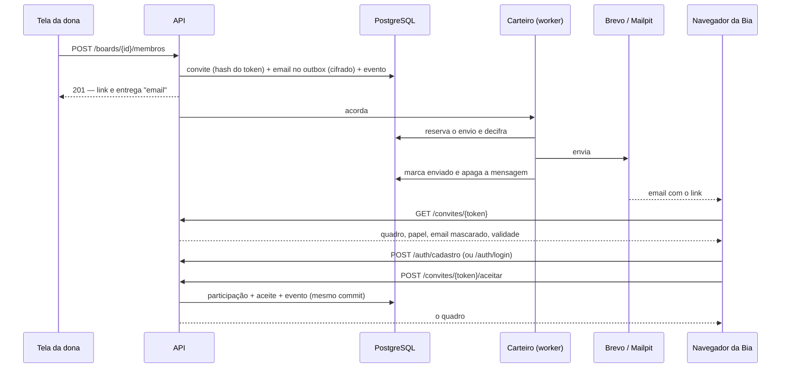

# 🧭 Funcionalidades e fluxos

> **Em uma frase:** tudo o que o stacktrack faz, uma funcionalidade por vez — o
> que a pessoa faz na tela, o que acontece por baixo e as regras que valem.
>
> Novo por aqui? Leia [como-funciona.md](como-funciona.md) antes. As rotas, o
> modelo de dados e as decisões técnicas estão em [arquitetura.md](arquitetura.md).

Cada seção segue o mesmo roteiro:

- **Na tela** — os passos de quem usa;
- **Por baixo** — o caminho no sistema: a rota, a regra, o que é gravado e quem
  fica sabendo;
- **Regras** — o que é recusado, e por quê;
- **No código** — por onde começar a mexer.

| | Funcionalidade |
|---|---|
| 👤 | [Conta e sessão](#-conta-e-sessão) |
| 🔑 | [Recuperar a senha](#-recuperar-a-senha) |
| 📬 | [Confirmar o email](#-confirmar-o-email) |
| 🗂️ | [Painel: seus quadros e os compartilhados](#️-painel-seus-quadros-e-os-compartilhados) |
| 🧱 | [O quadro](#-o-quadro) |
| 🧩 | [Colunas](#-colunas) |
| 🃏 | [Cards](#-cards) |
| 📎 | [O que pende de um card](#-o-que-pende-de-um-card) |
| 👥 | [Membros e papéis](#-membros-e-papéis) |
| ✉️ | [Convite por email](#️-convite-por-email) |
| 🔗 | [Link público de acompanhamento](#-link-público-de-acompanhamento) |
| 📜 | [Histórico do quadro](#-histórico-do-quadro) |
| ⚡ | [Tempo real](#-tempo-real) |
| 📱 | [No celular](#-no-celular) |
| 🌗 | [Tema](#-tema) |
| 📏 | [Limites, num lugar só](#-limites-num-lugar-só) |

---

## 👤 Conta e sessão

**Na tela**

1. **Criar conta**: nome, email e senha. Vindo de um convite, a tela avisa
   "você está aceitando um convite" e diz qual email usar.
2. **Entrar**: email e senha. Vindo de um convite, a tela diz com qual conta
   entrar.
3. Depois de entrar ou criar a conta, a pessoa vai para o **painel** — ou de
   volta ao convite, quando veio de um.
4. **Sair**, no cabeçalho, encerra a sessão.

**Por baixo**

- `POST /auth/cadastro` valida os dados no domínio, gera o hash da senha
  (Argon2id) e grava a conta **e** a primeira sessão no mesmo commit — uma
  falha entre as duas deixaria a conta criada e a pessoa vendo erro, e a
  segunda tentativa responderia que o email já está em uso.
- `POST /auth/login` confere a senha e abre uma sessão; `POST /auth/logout` a
  apaga no servidor. A sessão é um cookie `HttpOnly`; o banco guarda só o
  SHA-256 do token.
- O WebSocket aberto **revalida a sessão** a cada 30 segundos: sair em uma aba
  derruba o tempo real das outras.

**Regras**

- Senha com **15 caracteres ou mais**, e fora de uma lista local de senhas
  comuns. Comprimento protege mais que símbolo: "uma frase que só você diria".
- O email é normalizado (minúsculas, sem espaços nas pontas); um email por
  conta (**409** no segundo cadastro).
- A sessão vale **7 dias** a partir do login, fixos.
- O login responde a mesma mensagem genérica para email inexistente e senha
  errada, e gasta o mesmo tempo nos dois casos — nem o texto nem o relógio
  revelam quem tem conta.
- Tetos: 5 cadastros e 10 logins por minuto por IP; 5 falhas de login por conta
  em 5 minutos.
- O cadastro já sai **logado**, e a conta funciona inteira sem confirmar o
  email — só os convites no painel esperam a confirmação
  ([Confirmar o email](#-confirmar-o-email)).
- Esqueceu a senha? Ver [Recuperar a senha](#-recuperar-a-senha).

**O que ainda não existe**: trocar nome, email ou senha estando logado. Quem quer
trocar a senha usa a [recuperação](#-recuperar-a-senha), que funciona logado ou
não.

**No código**: `backend/internal/usecase/auth`, `domain/usuario`,
`adapter/http/handler/auth.go`; no frontend, `routes/cadastro`, `routes/login`
e `lib/stores/session.svelte.ts`.

---

## 🔑 Recuperar a senha

**Na tela**

1. No login, **Esqueci minha senha** — o email já digitado vai junto.
2. Em **Recuperar a senha**, o email e **Enviar link**. A resposta é sempre a
   mesma: "Se existe uma conta com esse email, mandamos um link para criar uma
   senha nova."
3. O email chega com o link, até quando ele vale e o que fazer se não foi a
   pessoa que pediu.
4. O link abre **Criar uma senha nova**, que diz de qual conta é
   (`c***@exemplo.com`). A senha nova, **Salvar a senha nova** — e a pessoa já
   entra, direto no painel.
5. Link usado, vencido ou inventado: **"Este link é inválido ou já venceu"**, e
   o botão **Pedir outro link**.

**Por baixo**

- O pedido e o email caem no **mesmo commit**, pelo mesmo outbox cifrado do
  convite: não existe link gravado sem email na fila.
- O banco guarda só o **hash** do token. O link é credencial — quem o tem troca
  a senha.
- Trocar a senha pelo link também **confirma o email** da conta: o link chegou
  pela caixa de entrada, que é a mesma prova do link de confirmação.
- Trocar a senha **encerra todos os links abertos da conta** e **apaga todas as
  sessões** dela, em qualquer aparelho: quem pede recuperação pode estar fazendo
  isso porque a senha vazou. Um WebSocket aberto cai na revalidação seguinte,
  em até 30 segundos.
- Duas redefinições simultâneas com o mesmo link passam **uma só**: a linha do
  link é travada, e a segunda a encontra já encerrada.

**Regras**

- O link vale **1 hora** e **uma vez**. Usado, vencido ou inexistente responde
  igual (**404**), para não ajudar quem testa links.
- **Pedir não revela quem tem conta**: com ou sem conta, e com o teto atingido,
  a resposta é a mesma (**202**), e nenhum email sai para quem não tem conta.
- **3 pedidos por conta por hora.** Pedir manda email a um endereço que qualquer
  um digita; o teto impede que alguém encha a caixa de entrada de outra pessoa.
  O excedente é ignorado em silêncio — avisar revelaria que a conta existe.
- A senha nova segue **as regras do cadastro** (15 caracteres ou mais, fora da
  lista de senhas comuns), e a recusa (**400**) **não gasta o link**.
- Tetos por IP: os do cadastro para pedir, os do convite para abrir o link, os
  do login para trocar a senha.
- Sem SMTP configurado, a recuperação responde igual e não manda nada — é o
  único fluxo que não tem como funcionar sem email.

**No código**: `usecase/auth/recuperacao.go`, `domain/recuperacao`,
`adapter/http/handler/recuperacao.go`, `adapter/email` (o texto); no frontend,
`routes/recuperar-senha` e `routes/redefinir-senha/[token]`. Os testes:
`e2e/recuperacao.spec.ts` (F1–F8) e `test/repository/recuperacao_test.go`.

---

## 📬 Confirmar o email

**Na tela**

1. Logo depois do cadastro chega um email **"Confirme seu email no stacktrack"**,
   com o link.
2. Até confirmar, o painel mostra o aviso **"Confirme seu email."**, com
   **Reenviar o email de confirmação**.
3. O link abre **"Email confirmado"** e o botão **Ir para o painel** — de qualquer
   aparelho, logado ou não.

**Por baixo**: o cadastro enfileira a confirmação logo depois do commit da conta
(`confirmacoes_email`, só o hash do token, e o email pelo mesmo outbox cifrado
do convite). `POST /auth/confirmacao/{token}` confirma; `POST /auth/confirmacao`
reenvia para a conta logada. O `/auth/me` diz `emailConfirmado`.

**Regras**

- **Para que serve**: liberar os [convites no painel](#️-painel-seus-quadros-e-os-compartilhados).
  Sem a prova, qualquer pessoa cadastraria o email de outra e veria — e
  aceitaria — os convites dela sem nunca ter recebido o link. A conta funciona
  inteira sem confirmar; o convite pelo link do email também.
- O link vale **7 dias** e **uma vez**; confirmar encerra os outros links abertos
  da conta.
- **3 envios por conta por hora**; para conta já confirmada, reenviar não manda
  nada.
- A confirmação sai **fora** da transação do cadastro, de propósito: uma falha ao
  enfileirar não pode desfazer a conta de quem já preencheu o formulário — quem
  não recebeu pede de novo.
- Trocar a senha pelo link do email também confirma.
- As contas criadas antes da confirmação existir começam **não confirmadas**:
  nenhuma provou nada ainda, e o aviso no painel oferece o envio.

**No código**: `usecase/auth/confirmacao.go`, `domain/confirmacao`,
`adapter/http/handler/confirmacao.go`; no frontend,
`routes/confirmar-email/[token]` e o aviso em `routes/painel/+page.svelte`.

---

## 🗂️ Painel: seus quadros e os compartilhados

**Na tela**

- **Convites para você**: os convites em aberto para o email da conta, de
  qualquer quadro — com o quadro, **"de Ana"**, o papel e até quando valem, e os
  botões **Aceitar** (abre o quadro) e **Recusar** (com confirmação). Só aparece
  para conta com o email confirmado.
- **Seus quadros**: os quadros em que você é dona ou dono, com a data de
  criação e o botão **Apagar**.
- **Compartilhados com você**: os quadros de outras pessoas em que você entrou
  por convite, cada um com **"de Ana"** (o dono) e o seu papel. A seção só
  aparece quando há algum.
- **Criar**: o nome do quadro no campo do cabeçalho do painel.

**Por baixo**

- `GET /boards` devolve os quadros de que a conta participa, com o papel e o
  nome do dono — a consulta parte de `board_membros`, e por isso é impossível
  ela trazer quadro alheio.
- `POST /boards` grava o quadro, a participação de quem criou como **dono** e o
  evento `quadro.criado`, no mesmo commit. O quadro nasce sem colunas.
- Apagar (`DELETE /boards/{id}`, só o dono, com confirmação) leva tudo em
  cascata: colunas, cards, etiquetas, checklists, comentários, anexos e o
  histórico. Quem estiver com o quadro aberto é levado para fora na hora.

**Regras**

- **Convites para você** existem só para conta com o email **confirmado**. O
  convite no painel dispensa o link, e o que prova que a pessoa é dona do email,
  no lugar dele, é a confirmação. Para conta sem confirmar, `GET /meus-convites`
  responde **403**.
- Aceitar pelo painel é o **mesmo aceite** do link — mesma transação, mesmo
  evento. Saber o id de um convite não vale nada: convite de outro email,
  vencido ou já resolvido responde **404**.
- **Recusar** encerra o convite (o link do email morre junto), tira da fila o
  email que ainda não saiu e registra **"recusou o convite"** no histórico do
  quadro — é por ali que quem convidou fica sabendo. A vaga fica livre: dá para
  convidar de novo.
- O convite no painel **vence junto** com o do email (7 dias): a validade é do
  convite, não do canal. Revogado, aceito ou vencido, ele some.
- Quem foi convidado como **dono** divide o quadro de verdade, e ele aparece em
  "Seus quadros".
- Participar de um quadro dá acesso **só a ele** — nunca aos outros quadros do
  mesmo dono.

**No código**: `usecase/board/quadros.go`, `routes/painel/+page.svelte`.

---

## 🧱 O quadro

**Na tela**

O cabeçalho mostra, da esquerda para a direita, o **estado** do quadro e as
**ações**:

| Estado | Quando aparece |
|---|---|
| avatares | quem está com o quadro aberto agora |
| seu papel | `dono`, `editor` ou `leitor` |
| selo **público** | existe um link de acompanhamento ativo — todo membro vê, para saber que o que escreve está à vista de fora |
| selo **conectando** / **reconectando** | o tempo real caiu, e a tela parou de se atualizar sozinha |

| Ação | Quem vê |
|---|---|
| **Ajustes** — etiquetas do quadro e fundo | editor e dono (o fundo, só o dono) |
| **Membros** e **Histórico** | todo membro |
| **Compartilhar**, **Renomear**, **Apagar** | só o dono |
| **+ Nova coluna** | editor e dono |

Abaixo do cabeçalho, a barra **Filtrar** (quando há pessoas ou etiquetas no
quadro): por **responsável**, por **etiqueta** e **só vencidos**.

As colunas formam uma **grade que quebra linha** — duas por linha no celular,
quatro no desktop —, e o que não cabe desce com a rolagem normal da página. Não
há faixa horizontal: ela escondia as últimas colunas atrás de uma barra que
ninguém vê sem procurar. Quadro sem colunas mostra o convite para começar por
**+ Nova coluna** (ou, para o leitor, que ainda não há nada ali).

**Por baixo**

- `GET /boards/{id}` traz o quadro inteiro — colunas, cards, etiquetas e o
  resumo de cada card — numa leitura só, sobre um instantâneo consistente do
  banco, carimbada com a **revisão** do quadro.
- Em seguida a tela abre o WebSocket (`/ws?board={id}&revisao={n}`), passando a
  revisão que já tem: o servidor manda só o que aconteceu depois dela.
- Etiquetas do quadro: `POST /boards/{id}/etiquetas`, `PATCH`/`DELETE
  /etiquetas/{id}`. Fundo: `PATCH /boards/{id}/fundo`.

**Regras**

- O **filtro é da tela**, não do servidor: ele esconde cards, e os critérios se
  somam ("da Ana" **e** "urgente"). Com o filtro ligado, **arrastar fica
  travado** — os vizinhos que a tela calcularia seriam os da lista filtrada, e o
  card pousaria no lugar errado.
- "Vencido" vem calculado **pelo servidor**: o relógio do navegador pode estar
  errado, e um card vermelho por engano confunde mais do que ajuda.
- Renomear uma etiqueta ou trocar a cor dela muda em todos os cards de uma vez —
  a etiqueta é do quadro, e o card guarda só a referência.

**No código**: `routes/painel/quadros/[id]/+page.svelte`, `lib/filtro.ts`,
`usecase/board/quadros.go`, `usecase/board/etiquetas.go`.

---

## 🧩 Colunas

**Na tela**

- **+ Nova coluna** no cabeçalho: título e cor.
- **Renomear** e trocar a **cor**: clicar no título da coluna abre os dois.
- **Reordenar** arrastando pela alça **⠿**.
- **Apagar** pelo **×** do cabeçalho da coluna, com confirmação — os cards vão
  junto.
- O cabeçalho mostra quantos cards a coluna tem.

**Por baixo**

- `POST /boards/{id}/colunas` cria no fim do quadro; `PATCH /colunas/{id}`
  renomeia e troca a cor; `PATCH /colunas/{id}/mover` reordena **pelos
  vizinhos**; `DELETE /colunas/{id}` apaga.
- Toda mutação grava a mudança e o evento no mesmo commit, sob o lock do quadro,
  e as outras telas recebem o aviso pelo tempo real.

**Regras**

- Coluna nova nasce com a **próxima cor livre da paleta** (`lib/paleta.ts`, que
  deixa o cinza por último, por parecer "sem cor").
- O título tem até 120 caracteres.
- Mover reescreve **uma linha** — a da coluna movida —, com uma chave entre as
  das vizinhas. O porquê está em
  [arquitetura.md](arquitetura.md#a-ordem-é-uma-chave-de-texto).
- Apagar a coluna manda os arquivos dos anexos dos cards para o outbox de
  exclusão, e não direto para fora do disco (ver [Anexos](#anexos)).

**No código**: `usecase/board/colunas.go`, `domain/coluna`, `domain/ordem`,
`lib/components/ColunaDoQuadro.svelte`.

---

## 🃏 Cards

**Na tela**

- **Criar**: o campo **"+ novo card"** no pé da coluna.
- **Abrir**: clicar (ou tocar) no card abre o **modal** com tudo o que pende
  dele.
- **Editar**: título, descrição (Markdown) e cor, no modal.
- **Mover**: arrastar para outra coluna, ou para cima e para baixo na mesma.
- **Apagar**: pelo **×** do card, com confirmação.
- No rodapé do card: responsáveis (iniciais), etiquetas (cor e nome), prazo,
  progresso das checklists (`3/7`), contagem de comentários e de anexos, sinal de
  que tem descrição e o selo **"movido por Ana há 5 min"**.

**Por baixo**

- `POST /colunas/{id}/cards` cria no fim da coluna; `PATCH /cards/{id}` edita;
  `PATCH /cards/{id}/mover` move **pelos vizinhos**; `DELETE /cards/{id}` apaga;
  `GET /cards/{id}` abre o modal, num instantâneo.
- O card se move na tela **na hora** (atualização otimista); se a API recusar,
  ele volta para onde o servidor diz que está.
- O selo de última movimentação vem do log de eventos: quem moveu, de onde para
  onde e quando — o tempo relativo acompanha o relógio, e não congela na hora em
  que a página abriu. O trajeto completo e a data exata ficam no `title` do selo.

**Regras**

- **Duas pessoas editando o mesmo card**: quem grava primeiro ganha, e a segunda
  é avisada. A tela manda a `version` que estava mostrando; se o banco já foi
  além, a API responde **409**, e a tela diz "alguém alterou este card enquanto
  você escrevia", **mantendo o texto digitado** para ser copiado antes de trazer
  a versão nova. Sobrescrever apagaria o trabalho da outra pessoa sem ninguém
  ficar sabendo.
- **Arrastar não confere versão**: mover é posicional, a última pessoa a soltar
  decide, e não há texto de ninguém para perder.
- Os vizinhos fora de ordem (a tela estava velha) respondem **409**, e a tela
  recarrega o quadro.
- O card **veste a cor da coluna** enquanto não escolhem uma para ele — e, por
  ser herança, e não cópia, muda de cor ao ser arrastado. Escolher a cor no card
  é dizer "este é exceção na etapa".
- Título até 200 caracteres; descrição até 5.000.
- A descrição aceita um **subconjunto de Markdown** — títulos, negrito, itálico,
  código, listas, citação e link —, renderizado à mão em `lib/markdown.ts`: o
  texto é escapado inteiro **antes** de as marcas virarem tags, e link só vale
  com `http(s)`.
- Card recém-criado **não** ganha selo de movimentação: "movido por quem criou"
  seria ficção.

**No código**: `usecase/board/cards.go`, `usecase/board/mover.go`,
`domain/card`, `lib/components/CardDoQuadro.svelte`,
`lib/components/ModalDoCard.svelte`, `lib/markdown.ts`.

---

## 📎 O que pende de um card

Tudo isto mora no **modal do card**. Editor e dono mexem; o leitor vê — e
comenta.

### Responsáveis

- **Na tela**: marcar e desmarcar quem responde pelo card, entre quem participa
  do quadro. Mais de um é normal: trabalho em par.
- **Por baixo**: `PUT`/`DELETE /cards/{id}/responsaveis/{usuarioId}`.
- **Regras**: só quem **participa do quadro** pode ser responsável — de fora
  responde **422**, e não 404: quem pediu já enxerga o card, e esconder o motivo
  não protegeria nada. A regra é do domínio, e não do banco (a chave estrangeira
  aponta para a conta, porque "quem pode ser responsável" muda com a regra).
  Sair do quadro **leva as atribuições junto**: mantê-las
  deixaria o nome de quem não tem mais acesso pendurado nos cards, e o filtro
  "meus cards" mostrando à pessoa removida cards que ela não abre mais.

### Etiquetas

- **Na tela**: aplicar e tirar etiquetas do quadro. No card elas aparecem com
  **cor e nome** — a cor sozinha só significa algo para quem decorou a convenção.
- **Por baixo**: `PUT`/`DELETE /cards/{id}/etiquetas/{etiquetaId}`.
- **Regras**: a etiqueta é **do quadro**, e o card guarda só a referência —
  renomear ou trocar a cor muda em todos os cards de uma vez, e apagá-la a tira
  de todos. Nome até 60 caracteres; a cor é da paleta (cinza, vermelho, laranja,
  amarelo, verde, azul, roxo, rosa).

### Prazo

- **Na tela**: a data de entrega; limpar tira o prazo. O card vencido fica em
  destaque e entra no filtro "só vencidos".
- **Por baixo**: `PATCH /cards/{id}/prazo` (`null` limpa).

### Checklists

- **Na tela**: várias por card, cada uma com itens marcáveis; o card mostra o
  progresso (`3/7`).
- **Por baixo**: `POST /cards/{id}/checklists`, `PATCH`/`DELETE
  /checklists/{id}`, `POST /checklists/{id}/itens`, `PATCH`/`DELETE
  /itens/{id}`.
- **Regras**: título até 120 caracteres; item até 500. Apagar a checklist leva os
  itens.

### Anexos

- **Na tela**: anexar um **link** (endereço e rótulo) ou um **arquivo**; baixar;
  apagar.
- **Por baixo**: `POST /cards/{id}/anexos/link`, `POST
  /cards/{id}/anexos/arquivo` (multipart), `GET`/`DELETE /anexos/{id}`. O
  arquivo vai para um volume próprio (`ANEXOS_DIR`), não para o banco — que
  incharia o backup de um schema que no resto guarda texto curto. É por isso que
  o backup tem [dois artefatos](producao.md#por-que-dois-artefatos).
- **Regras**:
  - **até 10 MiB** por arquivo (**413** acima disso), **20 anexos** por card e
    **1 GiB** de arquivos por quadro (**422** quando o conjunto não cabe — o
    arquivo em si pode estar dentro do limite); as cotas são conferidas
    **dentro da transação**, sob o lock do quadro, e dois envios simultâneos não
    passam os dois pelo último lugar;
  - **lista de permissão de tipos** (**415** fora dela): PNG, JPEG, GIF, WebP,
    PDF, texto, CSV, Markdown, ZIP e JSON. HTML e SVG ficam de fora de
    propósito — servidos da nossa origem, executariam script nela;
  - o **nome no disco é sorteado**, nunca derivado do que veio de quem enviou —
    nome de arquivo é entrada do usuário, e entrada do usuário não vira caminho.
    O nome original sobrevive só como rótulo;
  - o **download passa pela API**, que confere se quem pede participa do
    quadro, e sai como `attachment` com `nosniff`;
  - **apagar não apaga os bytes na hora**: a chave do arquivo vai para o outbox
    de exclusão, e o arquivo só sai do disco quando um backup externo comprovar
    que a exclusão está coberta. Até lá (o backup externo ainda não existe — ver
    [producao.md](producao.md#o-que-ainda-falta)),
    nada sai do disco — disco é barato, e um anexo apagado cedo demais não volta.

### Comentários

- **Na tela**: a conversa do card, do mais antigo para o mais novo, em Markdown;
  editar e apagar o próprio. O card mostra quantos comentários tem.
- **Por baixo**: `GET`/`POST /cards/{id}/comentarios`, `PATCH`/`DELETE
  /comentarios/{id}`.
- **Regras**: até 2.000 caracteres. Três regras diferentes, e confundi-las seria
  deixar alguém falar pela boca de outra pessoa:

  | | quem pode |
  |---|---|
  | **escrever** | qualquer participante, **inclusive o leitor** — acompanhar e responder é ver, não mexer |
  | **editar** | **só o autor**, nem o dono do quadro (**403** para os demais) |
  | **apagar** | o autor no próprio; o dono, em qualquer um |

  A assimetria entre editar e apagar é deliberada: tirar do quadro o que não
  serve é responsabilidade de quem administra, mas reescrever é pôr palavras na
  boca de outra pessoa. O comentário editado carrega a marca disso (`editadoEm`).
  A conversa é **append-only**: não tem posição e não se reordena — a ordem é a
  do tempo.

### Histórico do card

- **Na tela**: **Histórico ▸** no modal — quem criou, moveu, renomeou e comentou,
  e quando.
- **Por baixo**: `GET /cards/{id}/atividade`, um read model sobre o log de
  eventos — não há tabela própria.
- **Regras**: o evento guarda **nomes**, e não só ids: "moveu Migração para
  Pronto" continua dizendo isso mesmo depois de a coluna ser renomeada ou apagada.
  Pelo mesmo motivo, o evento de card apagado leva o título do card — depois do
  `DELETE`, não haveria de onde tirá-lo.

**No código**: `usecase/board/{responsaveis,etiquetas,checklists,anexos,comentarios,atividade}.go`
e `lib/components/ModalDoCard.svelte`.

---

## 👥 Membros e papéis

**Na tela** (`Membros`, no cabeçalho do quadro)

- A lista de quem participa, com nome, email e desde quando.
- Para o dono: trocar o papel de cada pessoa, **Remover**, o formulário de
  convite e a lista de convites pendentes (ver
  [Convite por email](#️-convite-por-email)).

| Papel | Ver | Editar colunas e cards | Comentar | Administrar |
|---|---|---|---|---|
| dono | ✅ | ✅ | ✅ | ✅ |
| editor | ✅ | ✅ | ✅ | — |
| leitor | ✅ | — | ✅ | — |

**Administrar** é convidar, trocar papel, remover, renomear e apagar o quadro,
trocar o fundo e ligar o link público.

**Por baixo**: `GET /boards/{id}/membros`, `PATCH`/`DELETE
/boards/{id}/membros/{usuarioId}`. Trocar o papel de alguém avisa a tela dela na
hora: quem foi rebaixado a leitor perde os botões de edição sem precisar
recarregar.

**Regras**

- **O quadro nunca fica sem dono.** O último dono não pode sair nem ser
  rebaixado — precisa promover outra pessoa antes. A regra é conferida de novo
  sob o lock: dois donos rebaixando um ao outro ao mesmo tempo não deixam o
  quadro órfão.
- **Quem não participa recebe 404**, nunca 403: um 403 confirmaria que o quadro
  existe. O 403 fica para quem é membro e esbarra no próprio papel.
- Papel desconhecido — dado estragado no banco — **não pode nada**.
- Remover alguém leva as atribuições de responsável junto; o que a pessoa
  escreveu fica.

**No código**: `usecase/board/membros.go`, `domain/membro`,
`routes/painel/quadros/[id]/membros/+page.svelte`.

---

## ✉️ Convite por email

O convite é a **única porta de entrada** de um quadro, tenha a pessoa conta ou
não. Conhecer o email de alguém não põe ninguém no quadro: o acesso nasce do
link do convite, apresentado por quem está logado na conta daquele email.

**Na tela — quem convida** (o dono, em `Membros`)

1. Informa o **email** e o **papel**, e clica em **Enviar convite**.
2. Vê **"Convite enviado para ana@exemplo.com"**, até quando ele vale e, por
   baixo, o link — para quem preferir mandar por outro meio. O link só aparece
   ali; quem o perder, reenvia e ganha outro.
3. Na lista de **convites pendentes**, acompanha cada um: *email na fila*,
   *email enviado em 24/10 15:02*, *o email não saiu* ou *sem email — entregue
   o link*. Cada convite tem **Reenviar** e **Revogar**.

**Na tela — quem é convidado**

1. Recebe o email, com o nome de quem convidou, o quadro, o papel, o link e até
   quando ele vale.
2. Abre o link: a tela mostra **"Ana convidou você"**, o quadro, o papel, para
   qual email o convite é (mascarado: `b***@exemplo.com`) e até quando vale.
3. **Sem conta**: **Criar conta** — a tela lembra qual email usar e recusa outro
   — e volta ao convite. **Com conta**: **Já tenho conta** — e volta ao convite.
   Trocar entre as duas telas no meio do caminho não perde o convite.
4. **Aceitar convite** — e o quadro abre. No painel, ele passa a aparecer em
   **"Compartilhados com você"**, com o nome do dono.
   - Com o email da conta **confirmado**, nem precisa do link: o convite também
     está em **"Convites para você"**, no painel, com **Aceitar** e **Recusar**.
5. Logado na **conta errada**, o convite não é aceito, e a tela oferece **Sair e
   entrar com outra conta**, voltando ao convite.

**Por baixo**

- O convite e a mensagem caem no **mesmo commit**: não existe convite gravado
  sem email na fila, nem email na fila de um convite que não existe. A falha do
  provedor de email nunca desfaz o convite.
- O link é credencial: o banco guarda só o **hash** do token, e a mensagem na
  fila fica **cifrada** e é apagada assim que sai. O email não leva nada do
  conteúdo do quadro além do título.
- Com o envio de email **desligado** (um ambiente sem SMTP), nada muda além do
  email: o convite nasce, e o link na resposta é a entrega.

**Regras**

- O convite vale **7 dias** e **uma vez**. Aceito, revogado ou vencido, o link
  responde "convite inválido ou expirado" — sem dizer qual dos três, para não
  ajudar quem testa links.
- **Aceitar exige a conta do email convidado**: um link encaminhado não vale para
  outra conta (**403**, e o convite não é consumido).
- **Reenviar** troca o link e renova a validade — também do convite vencido. O
  link anterior, inclusive o do email anterior, deixa de valer.
- **Revogar** derruba o link na hora e tira da fila o email que ainda não saiu.
- Convidar quem **já participa** ou **já tem convite em aberto** é recusado com o
  motivo (**409**).
- **Tetos** — porque convidar manda email a qualquer endereço, e sem teto uma
  conta usaria o remetente do stacktrack para mandar spam:

  | Teto | Valor | Estourado |
  |---|---|---|
  | convites em aberto por quadro | 50 | o convite é recusado (**422**) |
  | emails de convite por conta, em 24 h | 30 | o convite nasce, só com o link |
  | emails por convite | 5 | o reenvio gera o link, sem email |
  | intervalo entre dois emails do mesmo convite | 2 min | o reenvio é recusado (**429**) |

- Convidar, reenviar, revogar, recusar e entrar ficam no [histórico](#-histórico-do-quadro),
  com o email mascarado.
- O email falhou? Falha passageira tenta de novo sozinha, com espera crescente,
  por cerca de uma hora; recusa definitiva do servidor (endereço inexistente)
  desiste na hora. Nos dois casos a lista de convites mostra, e **Reenviar**
  resolve. A operação está em [producao.md](producao.md#-email-dos-convites).

**No código**: `usecase/board/membros.go` e `correio.go`, `usecase/correio`
(o worker), `adapter/email` (o texto e o envio), `domain/convite`,
`domain/email`; no frontend, `routes/convite/[token]`, `routes/cadastro`,
`routes/login`, `lib/navegacao.ts`.

---

## 🔗 Link público de acompanhamento

Convidar resolve o caso de quem vai **trabalhar** no quadro. Não resolve o de
quem só precisa **saber como vai** — o cliente, a diretoria, a área vizinha.

**Na tela** (o dono, em **Compartilhar**)

1. **Liga** o link e copia o endereço.
2. Quem o recebe abre e vê o quadro em **modo de leitura** — "somente leitura"
   dito com todas as letras —, sem conta e sem convite.
3. **Desliga**, com confirmação. O endereço morre na hora.

Enquanto o link existe, todo membro vê o selo **público** no cabeçalho do quadro.

**Por baixo**: `GET`/`PUT`/`DELETE /boards/{id}/publicacao` (só o dono) e
`GET /publico/{token}` (sem sessão).

**Regras**

- **O link é a credencial**: o endereço carrega um token de 256 bits, e não o id
  do quadro. Quem descobre o id não chega a lugar nenhum.
- Publicar duas vezes devolve o **mesmo** link — reabrir a tela não invalida o
  endereço já enviado. Religar depois de desligar gera um link **diferente**:
  quem guardou o antigo não volta a entrar.

  | Atravessa | Fica de fora |
  |---|---|
  | colunas, cards, descrições, etiquetas, prazos, progresso das checklists | comentários, anexos, histórico, responsáveis, membros, ids |

  A coluna da direita é regra, não recorte de tela: quem publica é o dono, e **o
  nome do colega não é dele para publicar** — nem a conversa da equipe.
- Ligar e desligar é **só do dono**: o token é o segredo, e um editor com acesso
  a ele publicaria o quadro por conta própria.
- A rota pública tem teto por IP, `no-store` e `noindex`.

**No código**: `usecase/board/publicacao.go`, `domain/publicacao`,
`lib/components/DialogoDeCompartilhamento.svelte`, `routes/publico/[token]`.

---

## 📜 Histórico do quadro

**Na tela** (`Histórico`, no cabeçalho do quadro)

- Tudo o que aconteceu no quadro, do mais recente para o mais antigo: card
  criado, movido, renomeado, apagado; coluna criada, renomeada, reordenada,
  apagada; etiqueta, anexo, checklist, item, responsável, comentário; quadro
  renomeado, fundo trocado; convites (inclusive a recusa de quem foi
  convidado); quem entrou, mudou de papel ou saiu.
- **Filtro por pessoa** — quem participa hoje **e** quem aparece no log, porque
  auditar costuma ser sobre alguém que já saiu — e o recorte **Só movimentações
  de card**. A tela abre mostrando tudo: quem chega ali está investigando, e um
  recorte ligado esconderia justo o que a pessoa ainda não sabe que procura.
- **Carregar mais**, de página em página.
- O email aparece sob cada nome: dois "Ana Silva" no mesmo quadro tornariam o
  histórico inútil exatamente quando ele é necessário. Não é exposição nova —
  qualquer membro já lê o email de todos na tela de membros.

**Por baixo**: `GET /boards/{id}/atividade?filtro=…&autor=…&antesDe={seq}` — a
página seguinte é pedida pelo cursor (`antesDe`), e não por número de página, e
a resposta diz se há mais. Nada novo é guardado: é uma leitura sobre o log de
eventos que o tempo real já usa.

**Regras**

- **Qualquer membro audita, inclusive o leitor**: ver o que aconteceu é ver, não
  mexer.
- **Reordenar dentro da própria coluna conta como movimentação** — é assim que
  uma coluna de prioridades é embaralhada.
- **Os nomes vêm do evento**, não das colunas de hoje: o log gravou o que era
  verdade na hora.
- **Cada ação tem o seu tipo de evento.** Doze delas — etiqueta, anexo,
  checklist, responsável, renomear o quadro, trocar o fundo — já foram gravadas
  como um único `quadro.alterado`, sem conteúdo: servia de aviso de "recarregue",
  e era inútil como histórico. O tipo é a identidade do que aconteceu, e um tipo
  genérico a apaga no momento da gravação. As linhas antigas continuam aparecendo
  ("mexeu no quadro"): o log é append-only, e um buraco onde houve atividade é
  pior que uma frase vaga.
- Nada do histórico sai pelo link público.

**No código**: `usecase/board/atividade.go`, `lib/atividade.ts` (as frases),
`routes/painel/quadros/[id]/historico`.

---

## ⚡ Tempo real

**Na tela**

- Uma pessoa move um card, cria uma coluna ou comenta, e a mudança aparece na
  tela das outras **sem recarregar** — inclusive no modal aberto do mesmo card.
- **Quem está aqui**: os avatares no cabeçalho, que somem quando a pessoa fecha
  a aba. Duas abas da mesma conta são **um** avatar.
- **Quem está editando esta coluna**: o nome aparece no rodapé dela para os
  outros — nunca para a própria pessoa.
- **Quando a conexão cai**: o selo **reconectando** aparece, a tela tenta de novo
  sozinha, com espera crescente (de meio segundo até 15), e ao voltar recebe o
  que perdeu enquanto esteve fora.

**Por baixo**

- Toda mutação grava a mudança e o **evento** no mesmo commit, com a **revisão**
  seguinte do quadro. O despachante lê o log e entrega pela sala do quadro, em
  ordem — inclusive para as outras abas da própria pessoa.
- A tela, ao receber um evento, **recarrega o quadro** em vez de aplicar a
  diferença: recarregar é sempre correto, e aplicar diferença por tipo de evento
  seria um lugar a mais para a tela discordar do banco. Vários eventos seguidos
  viram uma recarga só — por isso, num quadro que não para de mudar, a tela pode
  levar até 3 segundos para mostrar a última mudança.
- A presença é a exceção: entra direto, sem ir ao banco — recarregar o quadro a
  cada aba aberta ou fechada seria uma requisição por pessoa que entra.
- Ao reconectar, a tela informa a última revisão que aplicou, e o servidor manda
  o intervalo **antes** de voltar ao vivo. Mais de 200 eventos perdidos viram
  "recarregue tudo".
- O diagrama completo, e os limites da conexão, estão em
  [arquitetura.md](arquitetura.md#o-tempo-real).

**Regras**

- Presença e "quem está editando" são **efêmeros**: vivem só na memória da API,
  não têm tabela e morrem com o processo.
- Até **5 conexões por conta** e **100 no total**; o logout derruba o socket em
  até 30 segundos.

**No código**: `adapter/http/ws`, `adapter/realtime/{hub,despachante}`,
`lib/realtime/conexao.svelte.ts`, `lib/realtime/reconciliacao.ts`.

---

## 📱 No celular

- **Tocar** no card abre o modal — um toque curto continua sendo toque.
- **Tocar e segurar** (um quarto de segundo) é o que levanta o card para
  arrastar, como na tela inicial do celular. Sem essa espera, rolar a lista com o
  dedo levantava cards sem querer.
- Passar o dedo pela alça **⠿** da coluna **rola a página**, e não reordena;
  para reordenar, a mesma regra do card: segurar antes.
- O modal aberto por toque não se fecha sozinho, e apagar um card pede
  confirmação.

**No código**: `lib/arrastar.ts` (`ESPERA_DE_TOQUE_MS`) e `e2e/celular.spec.ts`.

---

## 🌗 Tema

- Claro ou escuro, pelo botão do cabeçalho; o padrão é o **escuro**.
- A escolha fica no navegador (`localStorage`) e é aplicada **antes** de a página
  pintar (`static/tema.js`), para não piscar a cor errada. Sem `localStorage`
  (janela privada), vale só na sessão.

---

## 📏 Limites, num lugar só

| O quê | Limite |
|---|---|
| título do quadro e da coluna | 120 caracteres |
| título do card | 200 caracteres |
| descrição do card | 5.000 caracteres |
| comentário | 2.000 caracteres |
| nome da etiqueta | 60 caracteres |
| título da checklist / texto do item | 120 / 500 caracteres |
| arquivo anexado | 10 MiB |
| anexos por card | 20 |
| arquivos por quadro | 1 GiB |
| senha | 15 caracteres ou mais |
| sessão | 7 dias |
| link de recuperação de senha | 1 hora, uma vez |
| link de confirmação de email | 7 dias, uma vez |
| envios de confirmação por conta | 3 por hora |
| pedidos de recuperação por conta | 3 por hora |
| convite | 7 dias, uma vez |
| convites em aberto por quadro | 50 |
| emails de convite por conta, em 24 h | 30 |
| emails por convite / intervalo entre eles | 5 / 2 minutos |
| conexões de tempo real | 5 por conta, 100 no total |
| reordenações seguidas no mesmo ponto | ~750 (aí a lista precisa de [reparo](producao.md#manutenção-do-banco)) |

**Disco sem margem** (menos de 2 GiB ou de 10% livres no volume dos anexos):
toda escrita que aumenta estado é recusada com **507**, e o resto continua —
ler, apagar, entrar e sair. Um quadro que não aceita card novo mas mostra o que
existe é um sistema degradado; um que não abre é um sistema fora do ar, e é
justamente olhando o que está lá que se decide o que apagar.

Os tetos de requisição (cadastro, login, rotas autenticadas e públicas) estão em
[arquitetura.md](arquitetura.md#tetos-de-requisição).
